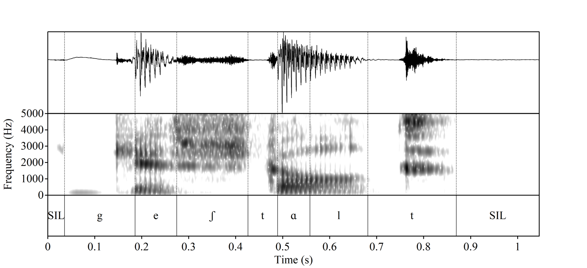
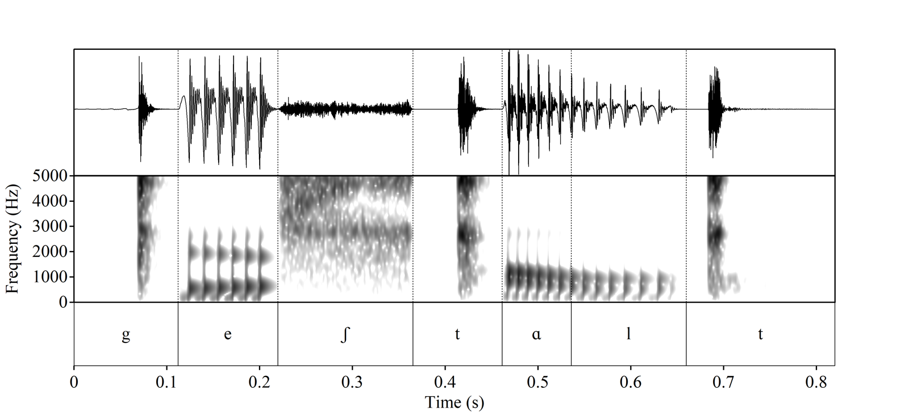

# Klatt synthesis and lexical stress perception

Coursework from *Speech Production and Perception* (MSc Linguistics, University of Edinburgh, 2026), cleaned up as a portfolio repo. Two parts:

1. **Klatt synthesis by hand.** Formant-synthesis scripts written parameter by parameter in Praat's KlattGrid, ending in a reconstruction of a recorded word (*gestalt*) from its spectrogram.
2. **Automatic resynthesis and a perception experiment.** A Praat script that reads an annotated recording, measures it, and rebuilds it as a KlattGrid, while trading F0 and F1 cues between syllables to make a 9 x 9 stimulus grid for *OBject* (noun) vs *obJECT* (verb). The stimuli were run as an online identification + AX discrimination experiment on Testable and analysed in R.

## Repository layout

```
klatt-exercises/            hand-built KlattGrid scripts
  ba, ha, i, sa, sa2        single syllables and vowels
  gestalt/                  full-word reconstruction, with spectrograms of
                            the recording and the synthesis
resynthesis/
  klatt_resynthesis_continuum.praat   TextGrid-driven copy-resynthesis + continuum
  examples/dog/             the same script run on a different word
experiment/
  stimuli/basis/            natural recording and TextGrid the continuum is built from
  stimuli/continuum/        the 81 stimuli used in the experiment (mp3)
  testable/                 trial template, discrimination trial list, R script
                            that generates it
  analysis/                 Quarto analysis, renv lockfile, de-identified data
```

## The gestalt reconstruction

| Recording | Synthesis |
|---|---|
|  |  |

Segment timing is defined once as a chain of landmarks (closure, burst, vowel onset, etc.), so changing one duration shifts everything downstream. F0 is set relative to a single base value so the whole contour can be moved for naturalness testing.

## Resynthesis and continuum

`resynthesis/klatt_resynthesis_continuum.praat` takes a recording with a two-tier TextGrid (tier 1: segments in IPA, tier 2: syllables labelled `s1`/`s2`) and:

1. tracks formants, intensity and F0 in the natural recording;
2. classifies each segment by manner and samples it every 5 ms, routing the values into the appropriate KlattGrid source and filter (voicing vs aspiration vs frication; oral vs frication formants), with a spectral centre-of-gravity check to find stop release;
3. scales F0 up in one syllable and down in the other, and F1 in the first syllable only, in 3.5% steps;
4. writes one stimulus per grid cell, named `<word>_f0_<i>_f1_<j>`.

The script is word-agnostic: `examples/dog/` shows it run on an unrelated monosyllable.

Run it from Praat (Open Praat script, then Run). Default paths point at `experiment/stimuli/`.

## Experiment

- **Identification:** all 81 grid cells, two-alternative forced choice (OBject vs obJECT).
- **AX discrimination:** two-step pairs along the F0 axis and the F1 axis at three anchor levels (steps 1, 5, 9), presented in both orders, plus same-pair trials. `experiment/testable/generate_disc_task.R` builds the list.
- **Analysis:** `experiment/analysis/spp_analysis.qmd` (identification heatmap, main-effect curves, discrimination by step pair, pilot). Restore packages with `renv::restore()` and render with Quarto.

## Tools and references

The following were consulted during development and are not redistributed here; see their own repositories and licences:

- Bujok & Bosker, F0 stress-continuum interpolation script (CC BY-NC 4.0)
- Matthew B. Winn, VOT continuum script
- Jalal Al-Tamimi, Praat spectral analyses of fricatives and stops

## Licence

Code: MIT (see `LICENSE`). Audio and data: CC BY 4.0.
